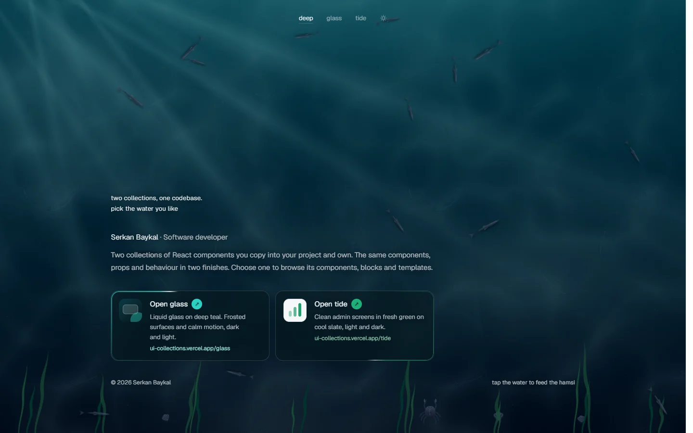
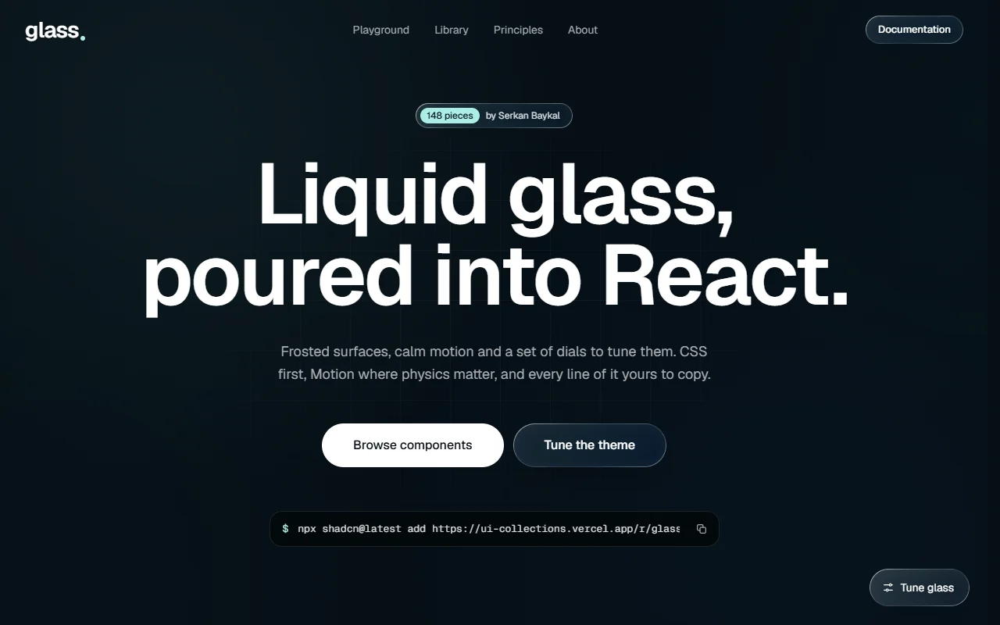
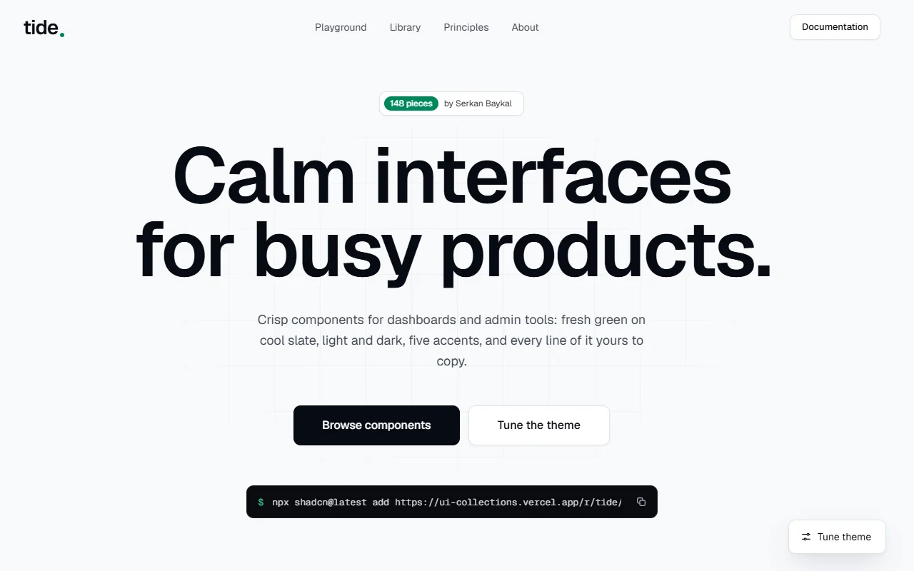

<div align="center">

# ui-collections

**Two collections of React components you copy into your project and own.**<br>
The same components, props and behaviour, in two finishes: **glass** and **tide**.

<br>

[](https://ui-collections.vercel.app)

[](https://ui-collections.vercel.app/glass)&nbsp;
[](https://ui-collections.vercel.app/tide)


<sub>Tip: Ctrl + click (⌘ + click on a Mac) opens a link in a new tab.</sub>

<br>

<a href="https://ui-collections.vercel.app">
  
</a>

<sub>The home page is a small sea. Tap the water to feed the hamsi; feed them too fast and a shark comes by.</sub>

</div>

<br>

## Two finishes, one library

<table>
  <tr>
    <td width="50%" valign="top">
      <a href="https://ui-collections.vercel.app/glass"></a>
      <h3><a href="https://ui-collections.vercel.app/glass">glass</a></h3>
      Liquid glass on deep teal. Frosted surfaces, calm motion and a set of dials to tune them, in dark and light.
    </td>
    <td width="50%" valign="top">
      <a href="https://ui-collections.vercel.app/tide"></a>
      <h3><a href="https://ui-collections.vercel.app/tide">tide</a></h3>
      Clean admin screens in fresh green on cool slate. Light and dark, five accents, built for dashboards.
    </td>
  </tr>
</table>

Both collections ship the **same** components. Each one styles itself through a small theme contract, so a fix or a new feature lands in every collection at once. Only the theme and the copy differ.

## What's inside

148 pieces per collection:

| | |
| --- | --- |
| **50 components** | Buttons, fields, dialogs, menus, tables, carousels, date pickers, command palette, account menu, status text… |
| **22 animated** | Dynamic Island, dock, fluid tabs, scroll text reveal, typewriter, tilt and spotlight cards, number ticker… |
| **56 blocks** | Heroes, pricing, auth flows, blog, careers, changelog, FAQ, footers, error and maintenance pages… |
| **12 patterns · 7 charts** | Filters, empty and loading states, area, bar, donut, funnel, heatmap and radial charts |
| **Lumen template** | A complete marketing site plus a 40-screen admin app with dashboards, mail, kanban, invoices and settings |

**Built to be owned.** CSS first, with Motion only where springs matter. Every interactive element has hover, press, focus and disabled states, keyboard support and accessible names. Reduced-motion settings calm animations down instead of switching them off.

## Install a component

Every piece is a [shadcn](https://ui.shadcn.com) registry entry. Open it on the site and copy its install command:

```sh
npx shadcn@latest add https://ui-collections.vercel.app/r/glass/button.json
```

Swap `glass` for `tide` to get the other finish. The code lands in your project; change it however you like.

## Run it locally

```sh
npm install
npm run dev
```

Open [localhost:3001](http://localhost:3001) for the home page, then [/glass](http://localhost:3001/glass) and [/tide](http://localhost:3001/tide).

| Script | What it does |
| --- | --- |
| `npm run build` | Builds the registry and the site for production |
| `npm run typecheck` | Type-checks the project |
| `npm run lint` | Lints the source |
| `npm run check:themes` | Checks every theme defines every token |

## Deploy

Import the repository into [Vercel](https://vercel.com) and keep the defaults; no settings or environment variables are needed. The collections live under `/glass` and `/tide`, so a free `*.vercel.app` address is enough.

<details>
<summary>Serving the collections on subdomains with your own domain</summary>

<br>

With a domain and wildcard DNS, each collection can live on its own subdomain (`glass.example.com`). Set:

```sh
SITE_URL=https://example.com
NEXT_PUBLIC_ROUTING=subdomain
COLLECTION_ORIGIN=https://{id}.example.com
```

</details>

## Project layout

```
src/
├─ registry/kit/   the installable source: ui, blocks, screens, dashboards, templates
├─ catalog/        metadata for every piece; drives the docs and the registry
├─ demos/          live previews and usage examples
├─ themes/         the theme contract and one stylesheet per collection
└─ app/main/       the home page
```

Contributor rules live in [AGENTS.md](AGENTS.md).

## Licence

[MIT](LICENSE) © Serkan Baykal. All images and video in `public/media` are original work, released under CC0.
